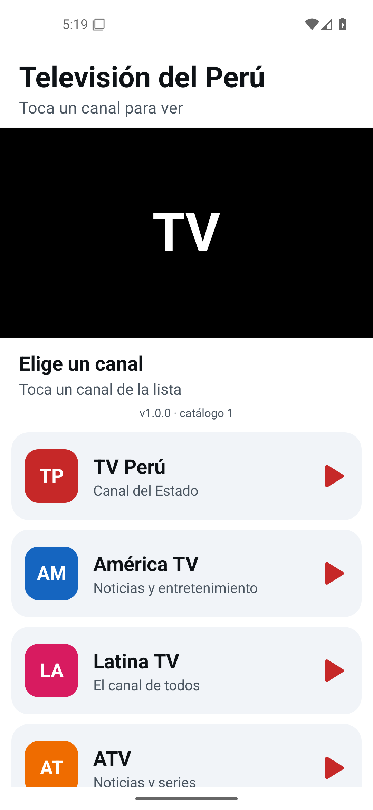
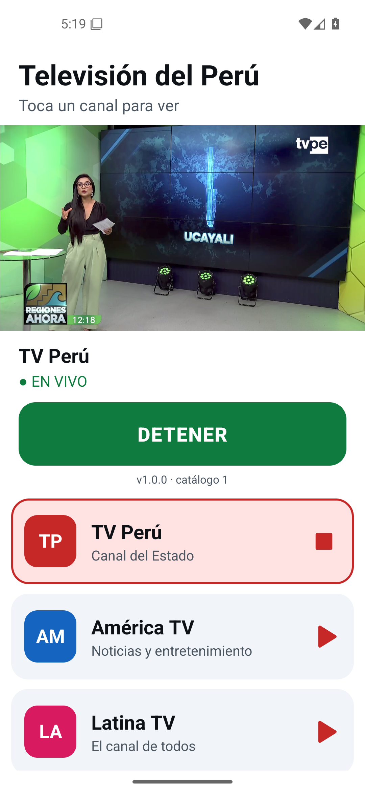
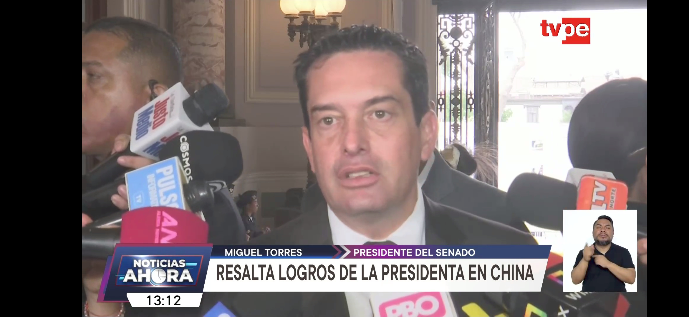

# Televisión del Perú

App Android minimalista para ver **canales peruanos de televisión en vivo**. Pensada para
personas mayores: una sola pantalla, letras grandes, un toque para ver y un botón grande
para detener. Sin cuentas, sin publicidad, sin analítica.

- **Paquete:** `pe.televisiondelperu.app`
- **Versión:** 1.1.0 (versionCode 2)
- **Android:** 7.0 (API 24) en adelante · targetSdk 36
- **Repositorio:** `github.com/carpediego/TelevisionDelPeru` (raíz del repo = raíz de la app)
- **Catálogo:** 20 canales verificados (14 nacionales/noticias y 6 regionales)

---

## Qué hace

```
┌──────────────────────────────────────┐
│ Televisión del Perú                  │
│ Toca un canal para ver               │
├──────────────────────────────────────┤
│                                      │
│           VIDEO 16:9                 │  PlayerView, sin controles propios
│                                      │
├──────────────────────────────────────┤
│ TV Perú                              │
│ ● EN VIVO                            │
│ ┌──────────────────────────────────┐ │
│ │            DETENER               │ │
│ └──────────────────────────────────┘ │
│        v1.1.0 · catálogo 1  Actualizar│
├──────────────────────────────────────┤
│ [TP]  TV Perú                        │
│       Canal del Estado               │
│ [AM]  América TV                     │
│ ...                                  │
└──────────────────────────────────────┘
```

- Tocar un canal reproduce el video en vivo en la zona superior.
- Un solo botón grande: **VER** cuando está en pausa, **DETENER** cuando se está viendo.
- Estados visibles y en letra grande: `Conectando…`, `● EN VIVO`, `En pausa`,
  `Sin conexión. Reintentando…`, `Este canal no está disponible. Prueba otro.`
- Al salir de la app el video **se pausa** (no sigue sonando a escondidas).
- El catálogo se actualiza solo desde GitHub; el código se actualiza desde la app.

### Pantalla completa (1.1.0)

- Con un canal puesto aparece **AMPLIAR** sobre el video. Al tocarlo —o al tocar el
  video— la app pasa a **pantalla completa** y gira a **horizontal**.
- En horizontal se ocultan la cabecera, el panel y la lista: queda el video y un botón
  **SALIR**.
- **SALIR** o el botón atrás vuelven a vertical y a la pantalla normal, sin cortar la
  reproducción.
- El video mantiene la proporción 16:9; según el teléfono pueden quedar franjas negras
  a los lados. Es mejor así que recortar el marcador o los logos del canal.

### Capturas

| Inicio | En vivo | Pantalla completa |
|---|---|---|
|  |  |  |

Tomadas en un emulador Android 15 (1080 × 2340). En un teléfono real se ven igual,
con el tamaño de letra del sistema.

---

## Cómo llega a los teléfonos

Hay tres cosas distintas y conviene no confundirlas:

| Qué | ¿Se actualiza solo? |
|---|---|
| **Catálogo de canales** (`catalog/channels.json` en GitHub) | **Sí.** La app lo descarga al arrancar (máx. 1 vez cada 15 min). Cambiar una URL no requiere compilar. |
| **Código de la app** | **Semi.** La app avisa y descarga la versión nueva, pero Android siempre pide confirmar la instalación. |
| **Primera instalación** | **No.** Hay que instalar el APK una vez (cable o copiándolo al teléfono). |

Subir el código a GitHub **no** actualiza los teléfonos por sí solo: hay que publicar un
*Release* con el APK y actualizar `version.json` (lo hace `tools\release.ps1`). Como la
firma es fija, el APK se instala **encima** sin desinstalar y sin perder nada.

---

## Actualizaciones dentro de la app

```
GitHub: version.json  ──►  la app compara versionCode
                              │
                    ¿hay una más nueva?
                       │              │
                      no             sí
                       │              │
              "Ya tienes la         aparece "Actualizar" al pie
               última versión"        │
                                      ▼
                         descarga el APK del Release
                         comprueba el sha256
                                      │
                                      ▼
                         abre el instalador de Android
```

- **Etiqueta al pie:** `v1.1.0 · catálogo 1`. Sirve también para soporte: "decime qué
  dice abajo".
- **Comprobación silenciosa:** al abrir la app, como máximo **1 vez al día**. Si hay
  versión nueva aparece un *Actualizar* chiquito al lado de la etiqueta; si no, no se
  muestra nada.
- **5 toques sobre el título "Televisión del Perú"** (seguidos, menos de 3 s): fuerza la
  comprobación aunque ya se haya hecho hoy. Si hay versión nueva, descarga y abre el
  instalador; si no, avisa "Ya tienes la última versión".
- **Seguridad:** se verifica el `sha256` de `version.json` y, como red final, Android
  rechaza cualquier APK firmado con otra clave.

La primera vez, el teléfono pedirá **"Permitir instalar apps de esta fuente"** para
Televisión del Perú (y Play Protect puede avisar: *Instalar de todos modos*). Es una sola vez.

### Publicar una versión nueva

1. Subir `versionCode` y `versionName` en `app/build.gradle.kts`.
2. `.\tools\release.ps1 -Notes "Qué cambió"` → compila, calcula el `sha256` y escribe
   `version.json`; deja `dist\TelevisionDelPeru-<versión>.apk` con nombre estable.
3. Crear el Release en GitHub (`releases/new?tag=v<versión>`) y subir ese APK.
4. `git add version.json; git commit -m "version <versión>"; git push`.

---

## Cómo se mantiene sola

```
GitHub: catalog/channels.json
   │
   ├── Robot cada 6 h: prueba las URLs y reordena / oculta las muertas
   │
   └── App: descarga el catálogo al arrancar (máx. 1 vez cada 15 min)
            y usa la copia embebida si no hay internet
```

1. Al arrancar, si pasaron más de 15 min desde la última comprobación, la app pide
   `catalog/channels.json` al CDN (primero `raw.githubusercontent.com`, luego jsDelivr).
2. Si la versión descargada es mayor y tiene al menos 3 canales válidos, la guarda y
   refresca la lista sin cortar el video.
3. Si el archivo llega corrupto o con menos de 3 canales, lo ignora y sigue con el suyo.

El robot (`.github/workflows/catalog.yml`) prueba cada candidato HLS: descarga el
manifiesto, comprueba `#EXTM3U`, baja a la primera variante y verifica que el primer (o
último) segmento responda 200/206 con contenido binario. Si un candidato falla y otro
funciona, lo sube al primer puesto. Si un canal falla 5 veces seguidas, lo oculta
(`active: false`). Si falla más de la mitad del catálogo, **no toca nada**: asume que el
problema es su propia red.

También se puede lanzar a mano: *Actions → Catalogo → Run workflow*.

**Regla de oro:** el robot y la app guardan siempre la **URL de entrada**, nunca la URL
final de la CDN. Muchos proveedores redirigen a una dirección con token que caduca en
minutos; guardar esa dirección dejaría el canal muerto al rato.

---

## Instalar en el teléfono

### Opción A — por cable USB

```powershell
& "$env:LOCALAPPDATA\Android\Sdk\platform-tools\adb.exe" devices
& "$env:LOCALAPPDATA\Android\Sdk\platform-tools\adb.exe" install -r ".\dist\TelevisionDelPeru-1.1.0.apk"
```

### Opción B — sin cable

Copia el APK al teléfono, ábrelo y acepta "Permitir instalar apps de esta fuente".
Si Play Protect avisa, elige **"Instalar de todos modos"**.

---

## Compilar

Requisitos: Android SDK 36, Gradle wrapper incluido y un JDK 21. El script busca el JDK
en este orden:

1. `JAVA_HOME`
2. `.\.toolchain\jdk-*`
3. `..\.toolchain\jdk-*`
4. `X:\APPS CREADAS\Radio\.toolchain\jdk-*`

```powershell
cd "X:\APPS CREADAS\Televisión"
.\build.ps1              # APK release firmado en dist\
.\build.ps1 -Debug       # APK debug (sin firmar)
```

El release exige `keystore\keystore.properties`. Si falta, el script se detiene: un APK
release sin firmar no sirve para actualizar.

---

## Publicar el catálogo

```powershell
node tools\validate.mjs          # solo informa
node tools\validate.mjs --fix    # reordena, cuenta fallos y sube la versión
```

Editar un canal: toca `catalog/channels.json` y haz commit. No hace falta compilar APK.
La app lo recogerá en la próxima apertura (o en 15 minutos).

Para añadir un canal hacen falta, como mínimo:

- `id` corto y único, `name`, `tagline`, `category`, `color`, `priority`.
- `candidates`: una o más URLs HLS (`.m3u8`) verificadas. Se puede añadir una segunda
  como respaldo.
- `active: true`.

No inventes URLs: si no se puede verificar, el canal se deja fuera.

---

## Firma del APK

`keystore/` está fuera de git a propósito. La keystore y sus contraseñas están en:

- `keystore\televisiondelperu.jks`
- `keystore\keystore.properties`
- `keystore\CREDENCIALES.txt` (contraseña y huella)

**Haz copia de esos archivos fuera del proyecto.** Sin la keystore no se pueden publicar
actualizaciones: habría que desinstalar la app en todos los teléfonos.

Huella SHA-256 de la firma:

```
65DF9FBFE6D6864014BD2DB6C27EACA0D50BA85229C3E79CEC959CDA02BF7805
```

La firma no se cambia nunca más.

---

## Arquitectura

```
TelevisionDelPeru/
├─ build.gradle.kts, settings.gradle.kts, gradle.properties, gradlew(.bat)
├─ local.properties            (sdk.dir; no va a git)
├─ build.ps1                   compila con el JDK del toolchain y deja el APK en dist\
├─ keystore/                   (no va a git) keystore.properties + .jks
├─ version.json                última versión publicada (lo lee el actualizador)
├─ catalog/channels.json       catálogo (única fuente de verdad)
├─ tools/validate.mjs          validador/reparador del catálogo (lo usa el robot)
├─ tools/release.ps1           compila, calcula sha256 y escribe version.json
├─ .github/workflows/catalog.yml  robot cada 6 horas
├─ README.md, PLAN.md
└─ app/src/main/
   ├─ AndroidManifest.xml
   ├─ java/pe/televisiondelperu/app/
   │  ├─ MainActivity.kt            pantalla: estado + órdenes + video
   │  ├─ catalog/Channel.kt         modelo
   │  ├─ catalog/CatalogRepository.kt  embebido + caché + descarga remota
   │  ├─ player/PlaybackService.kt  servicio: Media3, reintentos, reanudación
   │  ├─ player/LiveChannelPlayer.kt  play = volver al directo
   │  ├─ player/PlaybackStatus.kt   estado compartido servicio ↔ pantalla
   │  ├─ player/SessionState.kt     último canal (SharedPreferences)
   │  ├─ update/UpdateInfo.kt       lectura de version.json
   │  ├─ update/Updater.kt          comprobar, descargar, instalar
   │  └─ ui/ChannelAdapter.kt       lista de canales
   └─ res/                          layout, colores día/noche, strings, xml/file_paths.xml
```

### Reglas de reproducción

- **Un directo no se pausa.** Al dar play después de una pausa, `LiveChannelPlayer` vuelve
  a poner el mismo `MediaItem` y llama a `prepare()`: reconecta al momento actual, no al
  buffer viejo.
- **El servicio manda.** `PlaybackService` es dueño de ExoPlayer, de los reintentos, de la
  rotación de URLs y del canal recordado. `MainActivity` solo pinta `PlaybackStatus` y
  envía órdenes.
- **Reanudación del sistema.** `onPlaybackResumption` devuelve el último canal con
  `C.TIME_UNSET`; el `MediaButtonReceiver` del manifiesto permite que el play de la
  pantalla de bloqueo arranque la app aunque no esté viva.
- **Errores:** primero las URLs alternativas; después reintentos con espera 1,5 → 3 → 6 →
  12 s (máx. 4); si se agota, `UNAVAILABLE` y el botón queda para reintentar a mano.
- **Conexiones colgadas:** un vigilante revisa cada 3 s; si una conexión no responde en
  30 s, se trata como error y entra la cadena normal de candidatos y reintentos.
- **Al salir de la app se pausa.** `MainActivity.onStop` pausa el reproductor y suelta el
  `PlayerView` antes de liberar el `MediaController`. Al volver, el botón dice VER y
  reanuda en vivo.
- **Pantalla encendida** solo mientras se está viendo (`playerView.keepScreenOn`).
- **Audio focus** con `CONTENT_TYPE_MOVIE` + `USAGE_MEDIA`, y pausa al desconectar
  audífonos (`setHandleAudioBecomingNoisy`).

### Permisos

`INTERNET`, `ACCESS_NETWORK_STATE`, `FOREGROUND_SERVICE`,
`FOREGROUND_SERVICE_MEDIA_PLAYBACK`, `POST_NOTIFICATIONS`, `WAKE_LOCK`,
`REQUEST_INSTALL_PACKAGES`. Nada de ubicación, cámara, contactos ni almacenamiento.

`usesCleartextTraffic="true"` porque algunos streams públicos siguen en `http://`.

---

## Solución de problemas

**Se ve negro y no arranca.** Ejecuta `.\build.ps1` y mira el error. Si es de descarga de
dependencias, revisa la conexión a `dl.google.com` y `repo1.maven.org`.

**Un canal no carga.** Corre `node tools\validate.mjs` y mira el estado. Si falla, quita
o reemplaza la URL en `catalog/channels.json`. La app probará las alternativas que haya.

**Se corta en segundo plano (Xiaomi/Redmi, Samsung, Oppo).** El sistema puede matar el
servicio. Pide excluir la app del ahorro de batería en los ajustes del teléfono. Un video
no está pensado para seguir con la pantalla apagada; al volver, se reanuda en vivo.

**Ver errores en el teléfono:**

```powershell
& "$env:LOCALAPPDATA\Android\Sdk\platform-tools\adb.exe" logcat |
    Select-String "ExoPlayer|MediaSession|PlaybackService"
```

---

## Enlaces

- Repositorio: https://github.com/carpediego/TelevisionDelPeru
- Release 1.1.0: https://github.com/carpediego/TelevisionDelPeru/releases/tag/v1.1.0
- `version.json`: https://raw.githubusercontent.com/carpediego/TelevisionDelPeru/main/version.json

---

## Nota legal

Los streams son de terceros: la app **solo enlaza** direcciones públicas, no aloja, no
graba ni redistribuye video. Es de uso personal/familiar. Si algún día se publica en una
tienda, hay que revisar los derechos de cada canal.

---

## Estado de verificación

- [x] Proyecto compilando con AGP 8.13.2 / Kotlin 2.4.21 / Gradle 8.14.3 / JDK 21.
- [x] APK release firmado en `dist\TelevisionDelPeru-1.1.0.apk` (1,98 MB, esquema v2).
- [x] 20 canales verificados con `tools/validate.mjs` (manifiesto + variante + segmento).
- [x] Catálogo remoto, caché local y copia embebida.
- [x] Actualizador con `version.json`, `sha256` y `FileProvider`.
- [x] Robot de GitHub Actions cada 6 horas.
- [x] Pantalla completa horizontal con botón AMPLIAR / SALIR, sin cortar la reproducción.
- [x] Probado en emulador Android 15: abre, reproduce TV Perú, DETENER, pausa al salir,
      reanudación en vivo, reanudación tras muerte del proceso, modo avión con
      “Reintentando…”, notificación de reproducción, gesto de 5 toques, pantalla completa
      y vuelta a vertical con SALIR y con atrás.
- [x] Repo `github.com/carpediego/TelevisionDelPeru` creado y primer `push`.
- [x] Release `v1.1.0` con el APK publicado (`sha256` verificado).
- [x] Actualización 1.0.0 → 1.1.0 probada en emulador con los 5 toques: descarga,
      comprobación de sha256, instalador del sistema y app actualizada.
- [ ] Pruebas en teléfono real (instalar, reproducir, pausar 5 min, pantalla bloqueada,
      modo avión, reinicio, pantalla completa).
